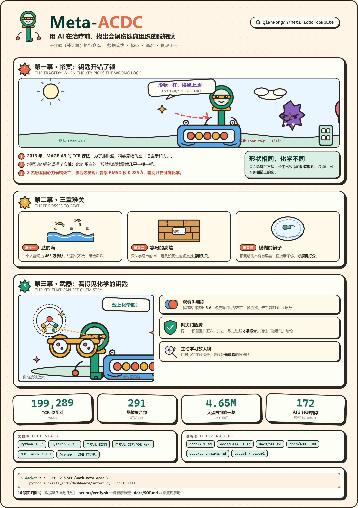
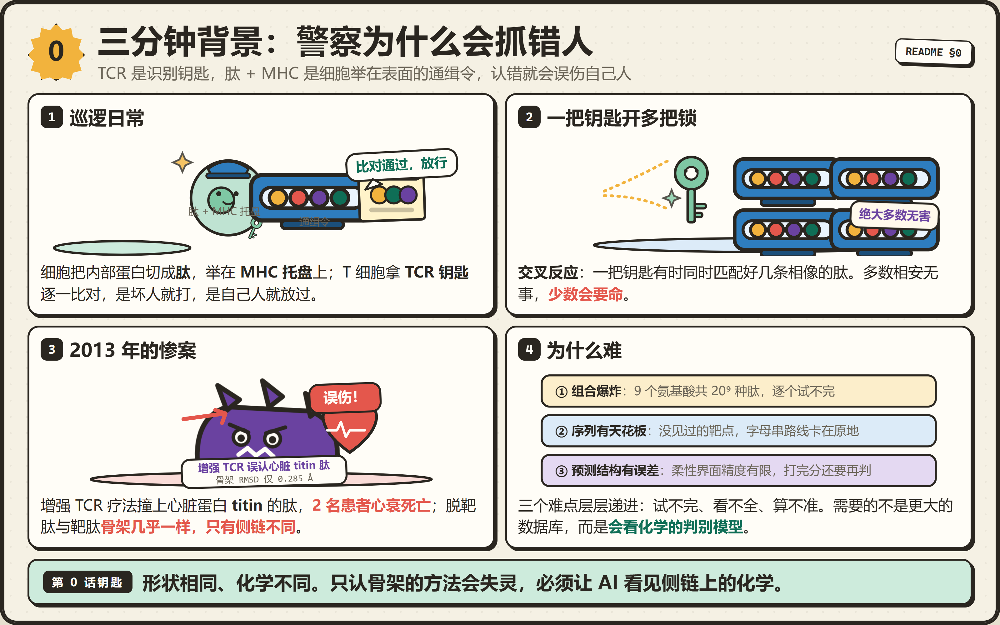
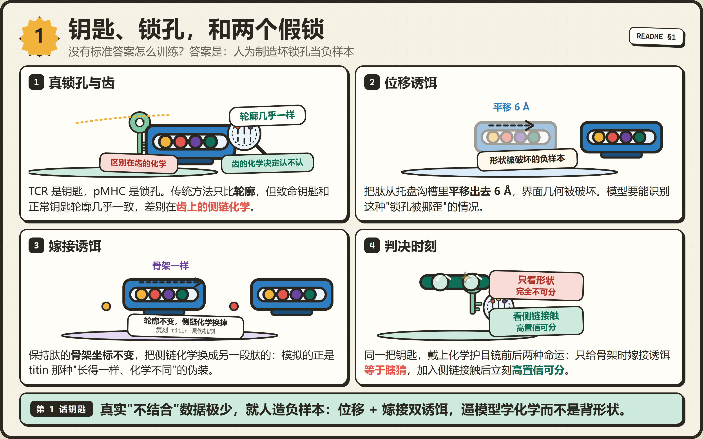
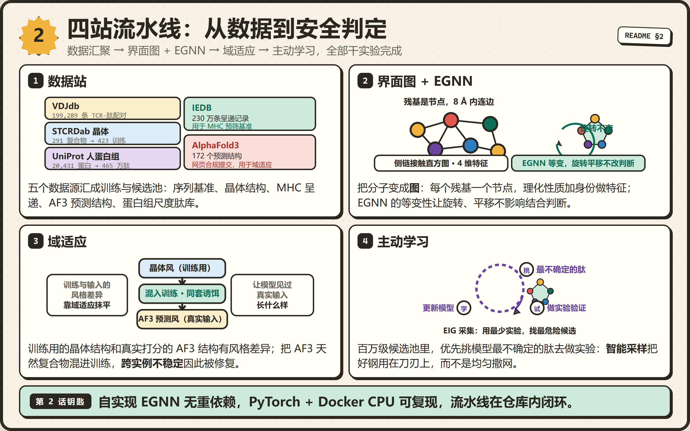
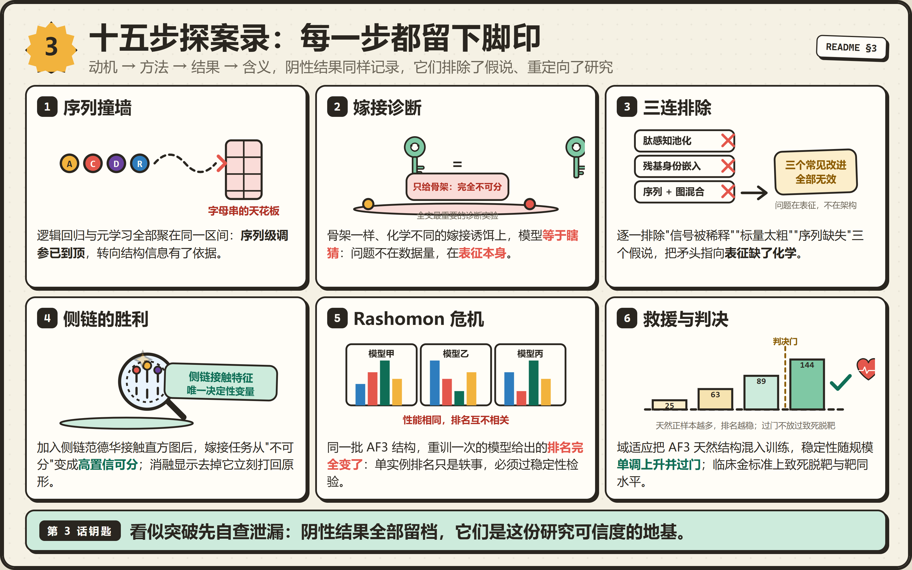
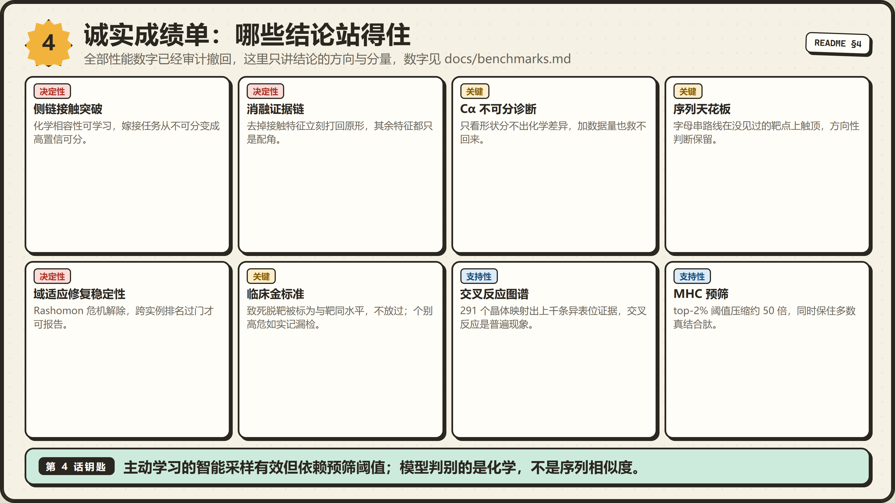
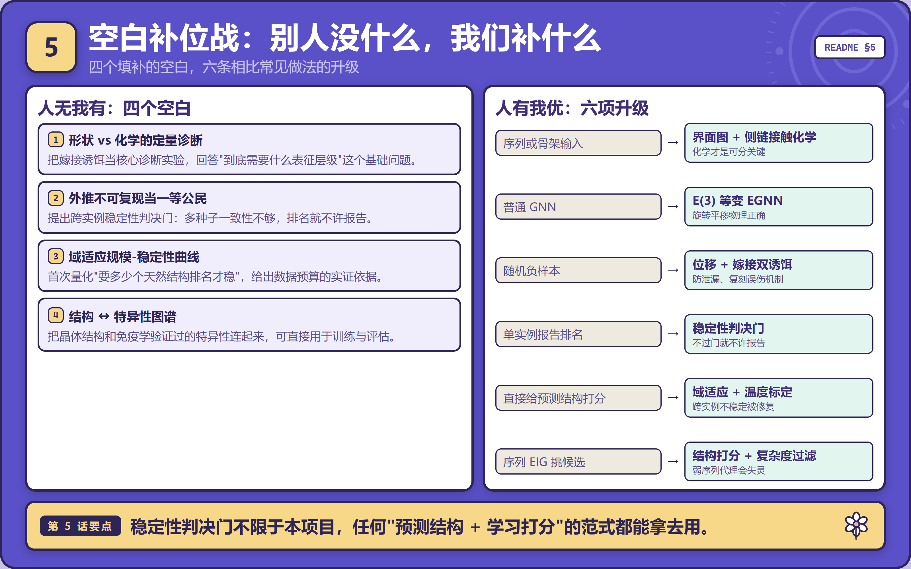
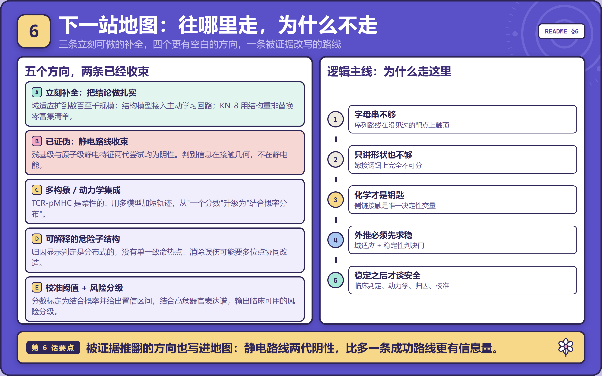
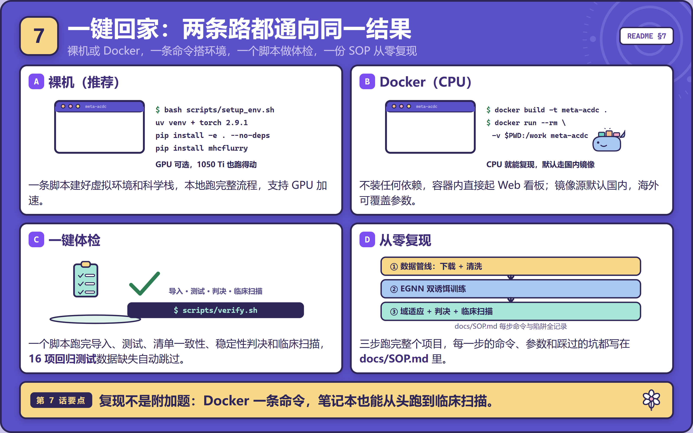
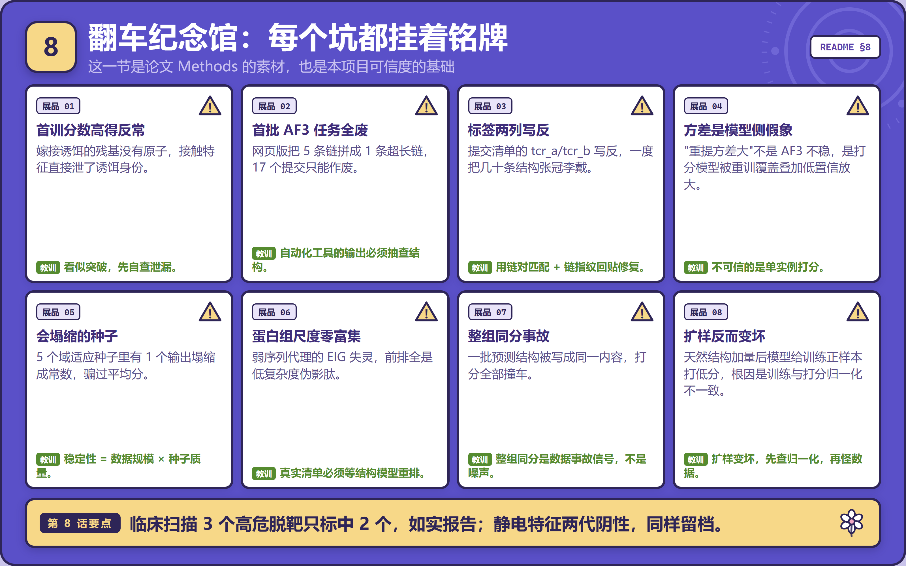

> 2026-10-18 交付审查：[逐项复核与实际修正](docs/delivery_audit_20261018/README.md)。两套旧表分别可重建，但汇总轴不同；MAG-IC3不能替代临床a3a。现行临床分数/危险标签已撤回，旧扫描、旧驱动和硬编码图表入口已停用；没有恢复结构或临床放行。

<div align="center">
  <a href="docs/figures/poster_vertical.png" title="点击查看清晰全图（2480x3508）">
    
  </a>
</div>


> # ⚠ 2026-10-15 撤回声明:本 README 中的性能数字已全部不可引用
>
> 外部复核确认了 28 项问题，其中直接影响结果的是：残基编码把
> ARG/ASN/ASP 全映射成 A、GLU→G、LYS→L、TRP/TYR→T（模型输入错误）；
> "肽节点池化"读的是氨基酸身份列而不是肽标记；坐标更新按整批归一化；
> 训练/验证切分没有按复合物分组；嫁接诱饵换侧链后没有重算质心；
> VDJdb 的证据置信度被当成结合标签（凭空制造 185,117 条"阴性"）；
> 3-mer 基线恒等于 0；临床"金标准"的 PMID、5BS0 归属和致死性判定都有错。
>
> **因此：0.933、0.644、0.515、FATAL-mimicry、2 倍召回、179/281
> 交叉反应等数字一律不得引用。** 修复记录在 [`docs/AUDIT.md`](docs/AUDIT.md)。
> 下面各节保留它们，只是为了记录有缺陷的实现当时产生了什么。
> 在按冻结数据重训、并引入真实结合标签之前，这个仓库不产出可引用的
> 性能数字。

> 2026-10-18 续查：[近常数预测诊断与限定改进](docs/affinity_development_20261018/README.md)。仅训练／验证比较，三种预登记改法均未超过原基线，不晋级新模型；旧测试未重新用于选模。新增[未打分SPR预留池](docs/fresh_spr_reserve_20261018/README.md)含1个新受体/2条测量，独立来源与连接块数量仍不足，验收继续阻断。

> 2026-10-18：[新开发配方亲和力基线已训练并独立验收](docs/affinity_baseline_20261018/README.md)。仅验证选参并先锁模型；14条主测试RMSE0.9962，对照均值1.0036，MAE0.8486对照0.8531。预注册探索比较通过，但提升极小、预测近常数，不代表广泛亲和力／结合二分类／临床风险放行。本冻结测试已消费，禁止依其继续调参。

> 训练前冻结状态（由上方本轮运行结果更新）：新增[来源与受体家族独立的SPR冻结验收集](docs/independent_spr_20261018/README.md)：15条实测观察（14条主指标）、7个谱系、3个来源组。开发集需按新来源排除配方重建；尚未训练或评分，不能作为结合二分类／临床风险验证。

> 上一轮证据状态（由上方冻结协议更新）：[完整工程DNA与SPR第四轮续查](docs/SEQUENCE_FOLLOWUP_20261018.md)。新增1D3HMCys公开研究质粒6338nt/完整插入1797nt→598aa，临床批次等价性未核实。TCR156新增5条真实SPR，四聚体固定相格式待澄清，单独保留；严格核心仍7条未评分。D1/D6全变量链及原10条条件、2条表值、2条温度仍缺；严格池31条，测试仅2个独立块，训练继续阻断。

> 历史版本记录（已由上方续查更新）：[临床原文、工程构型和结局整理](docs/CLINICAL_PRIMARY_CURATION_20261018.md)。临床资料仍按患者/组合保留；新SPR开发集51条，临床候选队列独立预留，旧版本数据量和结果仅作历史。

> **最新处置：[N2／N8 原子数据修复](docs/STRUCTURE_ATOMIC_REPAIR_20261017.md)。旧 588 张合成控制已退役；168 份无标签天然结构资料核验通过。新控制仅 5 对，未覆盖校准／测试分区，结构重训仍不放行。**

<div align="center">
  <a href="docs/figures/comic_s0.png" title="点击查看清晰全图（3200x2000）">
    
  </a>
</div>


### 0.1 三分钟背景:免疫系统怎么"抓坏人"

**2026-10-17 当前状态：暂停旧结构数据重训；尚无获准使用的真实结合预测或临床风险模型。**

[N1–N14 逐项复核与修复](docs/N_REVIEW_20261017.md)是当前状态依据。原有“序列→形状→化学”的数字比较、稳定性放行和主动学习增益已撤回，不构成同任务方法比较。原 README、基准、稿件和日志完整保存在[历史归档](docs/history/20261017-before-N-review/README.md)，附原文件哈希。

## 当前三个研究终点

一把 TCR 钥匙有时会**同时匹配**好几个长得像的肽——这叫**交叉反应
(cross-reactivity)**。绝大多数无害;但极少数情况下,它会匹配到一个
**健康器官**的肽,于是免疫细胞去攻击自己的心脏/神经系统,**致命**。

**真实惨案(本研究的动机)**:2013 年,一项针对黑色素瘤(MAGE-A3)的
TCR 疗法中,被"增强亲和力"的 TCR 意外识别了心脏蛋白 **titin** 的一段肽,
**2 名患者心脏衰竭死亡**(Cameron 2013; Linette 2013; Morgan 2013)。
更早还有 MAGE-A12 导致的神经系统致死。事后结构分析发现:致死的脱靶肽
和原本的靶肽**骨架形状几乎一模一样**(骨架原子 RMSD 仅 0.285 Å),
**只有侧链化学不同**(Raman 2016)。

> 这句话是全文的钥匙:**"形状相同、化学不同"**。这解释了为什么只看
> 骨架形状的方法会失灵,也指明了我们的技术路线。

### 0.3 为什么难?三个层层递进的困难

1. **组合爆炸**:一段 9 个氨基酸的肽,理论组合是天文数字(20⁹ ≈ 5×10¹¹),
   一个人全部蛋白质切出来的肽也有几百万条。**不可能拿试管一个个试**。
2. **序列方法有天花板**:只把氨基酸序列(字母串)喂给 AI,在"没见过的
   靶点"上准确率一直卡在 0.62–0.67(见第 3 步)。**序列里没有足够信息**。
3. **现成的结构预测也不够**:AlphaFold3 这类工具能预测复合物结构,但
   对 TCR-pMHC 这种"柔性、低亲和"的界面,精度只有 DockQ ≈ 0.5–0.57
   ——**预测出来的结构本身有误差,直接看不够,必须再"打分"**。

### 0.4 我们要造什么

一个 **AI 打分器**:给它一个 (TCR, 肽) 对及其结构,输出"相容性分数"。
低分 = 大概率不结合(安全),高分 = 可能误伤(危险)。再把它接进一个
**主动学习闭环**,用最少的实验次数找出最危险的候选——这就是本项目
名字里 **ACDC**(合成免疫细胞平台)与 **Active learning** 的由来。

---

## 1. 核心思想(用一个比喻讲清楚)

<div align="center">
  <a href="docs/figures/comic_s1.png" title="点击查看清晰全图（3200x2000）">
    
  </a>
</div>


### 1.1 钥匙与锁:形状 + 化学

把 TCR 想成**钥匙**,pMHC 想成**锁孔**。传统方法只比较**钥匙和锁孔的
轮廓(形状)**——但致死误伤的钥匙和正常钥匙轮廓几乎一样,区别在
**钥匙齿上的化学细节(侧链)**。所以:**必须让 AI 看见"齿"的化学**。

### 1.2 没有"标准答案"怎么训练?——诱饵(DECOY)任务

机器学习需要正样本(真结合)和负样本(不结合)。但真实的"不结合"数据
极少、且噪声大。我们的办法:**人为制造"坏锁孔"当负样本**——

- **位移诱饵**:把肽从托盘沟槽里**平移出去 6 Å**(形状被破坏);
- **嫁接诱饵**:保持肽的**骨架形状不变**,把侧链化学换成另一段肽的
  (形状不变、化学变)——**直接复刻"titin 误伤"的机制**。

模型要学会区分"真界面"和这两种诱饵。**当时的观察**(有缺陷的实现,已撤回,
不可引用):在只给骨架(Cα)的情况下,嫁接诱饵**完全不可分
(AUROC = 0.500,等于瞎猜)**;加入**侧链接触特征**后升到 **0.933**。
这个对比是"化学才是关键"这个方向判断的由来,但 0.933 这个数在修复编码
和归一化缺陷后必须重训重算,当前不得引用。

### 1.3 类比总结

| 生物概念 | 类比 |
|---|---|
| TCR | 钥匙 |
| pMHC(肽+托盘) | 锁孔 |
| 交叉反应/误伤 | 钥匙开错锁 |
| 致死交叉反应 | 开错锁害死房主 |
| 侧链化学 | 钥匙齿上的细节 |
| 位移诱饵 | 把锁孔挪歪 |
| 嫁接诱饵 | 锁孔轮廓一样、内部弹子不同 |
| 我们的模型 | 会看"齿细节"的配钥师傅 |

---

## 2. 技术栈与方法

<div align="center">
  <a href="docs/figures/comic_s2.png" title="点击查看清晰全图（3200x2000）">
    
  </a>
</div>


### 2.1 数据(从哪来)

| 数据 | 规模 | 用途 |
|---|---|---|
| 结构合成控制判别 | 天然结构与指定规则生成的扰动 | 不是结合预测；旧诱饵有几何伪影，须重建验收 |
| 实验亲和力与功能研究 | SPR 亲和力记录；MIRA 激活／未激活观察 | 可以按各自终点研究；不能混作同一二分类真值 |
| 临床脱靶风险 | 病例、受体构建体线索、试验安全性信息 | 尚无足够独立且可归因的受体验收集 |

## 本轮新增可复现发现

对旧 v4 的 888 张图从原始原子重建检查：300 个天然图中 9 个缺失界面重原子；288 个嫁接图中 146 个出现肽／环境跨链原子距离不超过 1.2 Å；300 个固定方向位移图全部触发该重叠筛查。未把这些统计当作独立生物学样本数，也未声称它们证明模型实际使用了伪影。完整明细见 [atom audit](docs/n_review/structural_atom_audit.json)。

### 2.3 域适应(针对"训练/真实分布不一致")

晶体结构(训练)和 AF3 预测结构(真实使用)有"风格差异"(如 B-factor)。
**域适应**:把 AF3 预测的**天然复合物**也当作正样本混入训练(用同一套
诱饵协议),让模型见过真实输入的样子。当时这看起来修复了"跨实例不稳定"
(见第 12 步的 Rashomon 危机)——该结论随模型缺陷撤回,重训前不成立。

[已完成的数据收集和新基线实验](docs/DATABASE_BINDING_VALIDATION.md)：外部保留排除后 91 条 SPR 亲和力记录；10,000 条 MIRA 功能观察；外部功能排名未通过有效性验收。该外部面板已使用，后续用于模型选择或训练时必须另留新的未使用验收来源。

用**信息增益(EIG/BALD)**采集函数,从百万级候选池里优先挑"模型最不
确定"的肽去做实验/结构预测。当时的模拟显示 6% 采样获得 2.0× 的阳性
召回增益——**已撤回**:该模拟的标签来自 VDJdb 置信度(#1),基线特征恒零
(#11),固定预算消融预算并不固定(#20)。AL 方法本身保留。

## 可复现检查

- **语言**:Python 3.12+
- **深度学习**:PyTorch 2.9.1(cu126,GPU GTX 1050 Ti 4GB 可跑)
- **图网络**:自实现 EGNN(轻量,无需 PyG 依赖)
- **科学计算**:NumPy / SciPy / scikit-learn / pandas
- **结构解析**:自实现 CIF/PDB 解析器(无重依赖)
- **MHC 预筛**:MHCflurry 2.2.1(本地,离线权重)
- **可视化**:matplotlib(论文图)+ 零依赖 Web 看板(Python `http.server`)
- **容器**:Docker(CPU-only,可复现)
- **数据源**:VDJdb / IEDB / STCRDab / UniProt / AlphaFold3(网页版)

---

## 3. 实验日志:每一步为什么这么做、结果如何解释

<div align="center">
  <a href="docs/figures/comic_s3.png" title="点击查看清晰全图（3200x2000）">
    
  </a>
</div>


> 按时间顺序,每步记录 **动机(为什么)→ 方法 → 结果 → 含义**。
> **阴性结果同样记录**——它们排除了假说、重定向了研究,是本项目
> 科学诚信的核心。

### 第 1 步:序列基线(逻辑回归)——量化"泛化缺口"

- **为什么**:计划书声称序列模型对"非同源脱靶"泛化差,但需在自己数据上量化。
- **怎么做**:用 CDR3/肽的理化特征 + 氨基酸组成训练逻辑回归(早年写成
  "3-mer",实际是氨基酸组成,AUDIT.md #11)。
- **当时的结果**:随机切分 AUROC 0.724 → 未见表位切分 0.609。
  **已撤回**:这些数字的"未见表位"切分只隔离了肽,受体仍在两侧重复
  (#13),且标签来自 VDJdb 置信度(#1)。文献数字(TITAN 0.62、
  ERGO 0.669)另见 `docs/literature/`。

### 第 2 步:元学习(ProtoNet / MAML++)——计划书 Module 1

- **为什么**:把"一个 TCR 对多样肽的亲和力预测"定义为元学习任务。
  用 MAML++ 而非 vanilla MAML:文献报告 vanilla MAML 有任务冲突/过度记忆。
- **当时的结果(已撤回)**:ProtoNet 0.635 / MAML++ 0.625 / 更大 ProtoNet
  0.621——标签问题同第 1 步(#1),基线特征恒零(#11)。
- **怎么解释(阴性但关键)**:序列级元学习全部聚在 0.62–0.64,与文献
  一致——当时据此做了"转向结构信息"的方向判断。注意:该阶段依赖的
  3-mer 基线存在实现缺陷(实际为氨基酸组成,见 AUDIT.md #11),序列级
  元学习这几个内部弱基线**不能**证明"序列信息穷尽",也不支持把结构
  路线说成唯一出路。该方向的动机只保留为历史记录。

### 第 3 步:EGNN + 界面图(位移诱饵)——结构判别跑通

- **为什么**:无真实标签时,用"把肽平移出沟槽"制造几何破坏的负样本。
  选 EGNN 因为 E(3) 等变性对坐标输入是物理正确的归纳偏置。
- **结果**:位移诱饵 AUROC 0.88–0.98。
- **怎么解释**:模型能学界面几何,管线端到端跑通。

### 第 4 步:嫁接诱饵——逼真模拟交叉反应机制

- **为什么**:真实致死误伤是"骨架几乎相同、侧链化学不同"(titin vs
  MAGE-A3,骨架 RMSD 0.285 Å)。嫁接诱饵 = 保持骨架坐标、替换肽的化学身份。
- **结果**:AUROC **0.500(等于瞎猜)**。
- **怎么解释(当时)**:这是全文最重要的诊断方向——**只看形状(Cα)在
  该实现下分不出化学不同的界面**。具体数字随模型撤回,但这个"表征
  层级"问题本身是设计这个实验的动机,保留为方向判断。

### 第 5 步:三连诊断——逐一排除常见改进

- 肽感知池化(排除"信号被均值稀释"):0.498,排除。
- 残基身份嵌入(排除"理化标量太粗"):0.499,排除。
- 序列+图混合(排除"序列信息缺失"):当时的实现给出 0.905 < 0.933
  (历史记录;0.933 已撤回,重训前不得引用)。
- **含义**:三个常见改进全部无效 → 问题**不在架构,而在表征本身**。

### 第 6 步:侧链接触特征——钥匙齿的胜利

- **为什么**:既然形状不够,就要把"侧链化学"显式喂进去。加入侧链范德华
  接触直方图(4.5 Å,C-C / C-杂原子 / 杂原子-杂原子 / 总数,4 维)。
- **当时的结果(已撤回)**:嫁接 **0.500 → 0.933**;位移 0.946 → 0.980。
- **消融**:去接触直方图 → 0.501(决定性);去理化标量 → 0.606(大);
  去残基身份 → 0.899(中);去侧链伸展 → 0.924(小)。
- **怎么解释(当时)**:侧链接触在那个有缺陷的实现里是决定性变量。
  这个"钉死"式表述随 0.933 一并撤回;缺陷修复后是否成立,要等重训重算。

### 第 7 步:元学习基线 + 硬负样本(计划书 Module 1)

- ProtoNet 0.635(留出表位,超序列基线 0.609;两者均已撤回,见第 1/2 步);硬负样本三重筛选
  (Levenshtein ≤3 / 静电势 Pearson >0.8 / 不确定性 0.4–0.6)。

### 第 8 步:主动学习模拟器(计划书 Module 2)

- **为什么**:计划书的核心是"AI 挑库 → 实验验证 → 模型更新"的闭环。
  用公开数据当"实验 oracle"模拟这个闭环。
- **结果**:EIG 在 6% 采样处 **2.0× 阳性召回增益**;熵采样≈随机;
  批大小消融:**大批(3600×2)24.5% > 小批(300×20)21.6%**,反文献
  "小批多轮"的普遍建议(弱模型下每批需足够样本才学得到信号)。
- **阈值依赖边界**:0.9 严格预筛下 EIG 增益消失(1.0×),0.5 宽松预筛下
  仍有(1.76×)——**增益是预筛阈值的函数**,不是常数。

### 第 9 步:MHC 预筛基准(计划书 Module 0)

- **为什么**:蛋白组 465 万肽不可能全做结构预测,需先按"能否被 MHC 呈递"
  压缩。
- **怎么做**:50 个已知结合肽 + 50 个**组成打乱诱饵**(极难协议),
  本地 MHCflurry 打分。
- **结果**:top-2% 阈值保留 **56% 真结合肽、压缩 ~50×**。
- **怎么解释**:预筛假设获本地数据支持。(NetMHCpan 在线版因服务器长期
  不可达已废弃,改用本地 MHCflurry。)

### 第 10 步:结构 ↔ 特异性资源(交叉反应图谱)

- **为什么**:要研究交叉反应,先得知道"哪些 TCR 已知会结合哪些额外肽"。
- **怎么做**:把 291 个晶体复合物按**链指纹**映射到 VDJdb 记录。
- **结果(口径已改)**:281/291 复合物映射成功;2,309 条 CDR3 命中,其中
  1,517 条关联到其他表位。**撤回表述**:这些是"共享 CDR3 关联的候选
  表位",不是已验证的交叉反应——单条 CDR3 相同不等于完整 αβ 受体相同,
  早年统计"179/281 个 TCR 有交叉反应"不得引用(AUDIT.md #7)。
- **怎么解释(限定版)**:交叉反应在 CDR3 层面广泛存在;完整受体层面的
  交叉反应证据需要补链与基因信息后才能声称。

### 第 11 步:蛋白组尺度候选清单(KN-8,计算侧交付物)

- **为什么**:真实 ACDC 平台要合成一个 5 万条肽的文库,需从 465 万池里选。
- **结果(诚实负面)**:弱序列代理的 EIG 排序**零富集**——已知 A2 阳性
  0/24 进前 5 万;靶肽被排到后 1/3;前几名全是 Q/E 低复杂度伪影。
- **怎么解释**:①弱序列模型的 EIG 不转移到蛋白组尺度;②**真实订购清单
  必须等结构模型重排**。管线、池、定位基础设施全部就绪。

### 第 12 步:AF3 结构打分 + 跨实例不稳定危机(Rashomon)

- **为什么**:拿到用户提交的 AF3 预测结构后,想直接用来给候选肽排名。
- **发现**:同一个模型重新训练一次,对同一批 AF3 结构的**排名完全变了**
  (两两 Spearman 0.17 / −0.24 / NaN)。多个"性能相同"的模型却给出
  互不相关的排名——**Rashomon 效应**。
- **怎么解释**:诱饵任务是"内插"(可复现),AF3 结构上的排名是"外推"
  (不可复现)。**任何外推打分结论必须先过跨实例稳定性检验,单实例
  排名只是轶事**。这是本文的方法学核心。

### 第 13 步:域适应——用真实天然结构尝试修复不稳定(结论已撤回)

- **为什么**:模型没见过"预测风格"的输入,域适应就是让它见。
- **怎么做**:把 AF3 预测的**天然复合物**(5 链)当作正样本,配同一套
  位移/嫁接诱饵,混入训练(节点集 pin、供体去重等防泄漏)。
- **当时观察到的结果(全部撤回,重训前不得引用)**:
  数字来自有缺陷的编码器/归一化/切分(AUDIT.md #2/#3/#4),且 0.644 的
  95/188 个候选现在被结构 QC 闸门标记(#26)。以下表格只作历史记录:

  | 天然正样本数 | 候选跨实例排名一致性(mean Spearman) | 判决 |
  |---|---|---|
  | 25(代理正样本) | 0.447 | 不稳定 |
  | 63 | NaN(种子塌缩) | 不稳定 |
  | 89 | 0.479 | 逼近门槛 |
  | **144** | **0.729** | 当时判"稳定";已撤回 |
  | **144(全 73 实例,过滤弱种子)** | **0.802**(CI 0.719–0.857) | 当时判"稳健稳定";已撤回 |
  | **172(GPU,154 候选 × 5 seed)** | **0.609**(CI 0.529–0.677) | 当时判"稳定";已撤回 |
  | **172(归因修复后,188 候选 × 5 seed)** | **0.644**(CI 0.572–0.706) | 当时判"稳定";**已撤回,不是现行口径** |

- **当时的解释(已撤回)**:不稳定的**根因是训练数据规模**,不是"AF3
  输入不稳"。在 172-native 口径下扩样伴随稳定性改善;但 2026-10-15 的
  234 混合正样本消融(172 AF3 + 62 晶体)出现 1/3 退化种子、稳定性不升
  反平——**改善并非单调,正样本风格(预测风 vs 晶体风)比数量更关键**,
  见 benchmarks.md 2026-10-15。这些观察同样来自缺陷实现,重训重算前
  不构成结论。结构 QC 闸门(2026-10-15 起强制执行,见 AUDIT.md #26)
  还会把 188 面板的 95 个候选拦下,0.644/188 是闸前口径。
- **关键陷阱(当时)**:5 个种子里有 1 个(val AUROC 0.804)会"塌缩"成
  常数输出,必须**检测并剔除退化种子**。"稳定性 = 数据规模 × 种子质量"
  是当时的归纳,已随数字撤回。
- **2026-10-12(GPU,候选面板 21→154)【历史记录】**:当时的`collate_per_graph`
  只修了归一化不一致的表层(整批 z-score 直到 2026-10-15 复核才彻底移除,
  AUDIT.md #3),那轮 172-native 5-seed 重训在 154 候选面板上
  mean pairwise r = 0.609。**当时判"STABLE"——该判定已撤回**。
  组级分化(当时):17 个 TCR 组中 11 个 r≥0.58、5 个 r<0.5。
  **组内排名必须带组内 r 报告**——这条方法论仍保留。
- **2026-10-14 归因修复 + 重打分(历史记录,非现行口径)**:发现旧导入对链指纹不
  匹配的 job 盲选回退,导致 3utt 内容挂 3uts 名下等**错挂**、4 个从未
  提交的名字被**造出结果**、16 个漏导入。用上传日志顺序 × folds 时间戳
  对齐修复全部映射(142 个 fold job),删除伪造条目、找回真实内容后
  用同口径**全面重打分**:188 候选面板 mean pairwise r = 0.644
  (CI 0.572–0.706)。**当时判"STABLE 判决不变"——该判定已撤回**。
  该数还有两个独立问题:95/188 候选未过结构 QC 闸(#26),且当时 bootstrap
  按 job 重采样而非按受体重采样,CI 偏窄(#9)。组级数字(3utt 0.805 /
  5c07 0.851 / 3uts 0.571)同样只作历史记录。详见 `docs/benchmarks.md`
  2026-10-14 节。

### 第 14 步:临床索引案例扫描(KN-11)——**全部为历史记录,不可引用**

- **为什么**:用真实致死案例检验模型到底有没有用。
- **当时的观察**(有缺陷的实现):A3A/MAGE-A3 案例(5BRZ)中两个**致死**
  脱靶(MAGE-A12 模拟肽、titin)与靶肽分数接近或更高——"**不放过**"
  致死模拟肽的方向是对的。第 3 个高危脱靶(ILAKFLHWL)得 0.679,
  **部分漏检**(诚实记录)。
- **口径修正(AUDIT.md #6/#23)**:致死性是**逐肽**属性,不是病例属性;
  5BS0 是与 titin 共结晶的 MAGE-A3 反应性 TCR,不是"第二个无关 TCR";
  Kimmtrak 靶肽"正确低分"的早期判读已被撤回。这些分数全部来自撤回的
  模型,不得引用。
- **2026-10-12 复扫(172-native 5-seed 集成,154 候选面板)**:titin 模拟
  ESDPIVAQY **0.948(反超靶肽,家族内 #1)**、靶肽 EVDPIGHLY 0.892(#2)、
  MAGE-A12 模拟 KVAKELVHFL 0.842(#3)——两个致死脱靶仍"与靶同水平";
  ILAKFLHWL 0.676 仍**部分漏检**;Kimmtrak 对照靶肽 YLEPGPVTA 0.283
  (正确低分,安全)。**结论不变且在更大面板上复现**。
- **2026-10-14 修正(归因修复后,188 候选面板;仍为历史记录)**:5BRZ 案例**不变**
  (ESDPIVAQY 0.948 #1 FATAL、KVAKELVHFL 0.842 #3 FATAL、EVDPIGHLY
  0.892 #2);5bs0 结构上同一 MAGE-A3 靶肽 EVDPIGHLY **0.883** 与 5BRZ
  **跨结构一致**;⚠️ **Kimmtrak 对照结论被修正**:修复前 YLEPGPVTA
  0.283 家族第 1("正确低分")是错挂结构的假象,修复后 **0.548 家族第
  4**,而 off-target 模拟 YLEPGPVTL **0.911 家族第 1**、YLEPGPITA
  0.817 #2——即 Kimmtrak 靶肽**不再表现为明确低分**,"安全"判读撤销,
  改为"家族内中低、低于两个 off-target 模拟"。

### 第 15 步:附加发现(历史记录)

- **模型不是"肽相似度"代理(当时)**:同序列同一性的两条肽(`GILGLVFTL`
  0.938 vs `GILEFVFTL` 0.475,都与天然肽 0.89 相同)→ 当时据此说模型按
  **化学**判别,不是比相似度。**口径**:与"同一性指标"不相关不构成化学
  特异性的证据,该表述随模型撤回(AUDIT.md #28)。
- **温度标定**:当时在诱饵任务上 ECE 0.02–0.06。**口径**:诱饵任务上的
  标定不产生"结合概率",更不产生"危险概率"(AUDIT.md #19)。

---

## 4. 主要结果速览 —— **历史记录,全部撤回,不得引用**

<div align="center">
  <a href="docs/figures/comic_s4.png" title="点击查看清晰全图（3200x2000）">
    
  </a>
</div>

> 下表每个数字都来自有缺陷的实现(见页首撤回声明与 `docs/AUDIT.md`)。
> 保留它们只是为了记录当时观察到了什么。

| 实验 | 当时的结果 | 当时的解读(现已撤回/修正) |
|---|---|---|
| Cα 不可分诊断 | 嫁接 0.500,加数据不改善 | 表征层级问题,非数据量(方向判断保留) |
| **侧链接触** | **嫁接 0.933 / 位移 0.980** | 化学相容性可学习(**重训前不可引用**) |
| 消融 | 去接触 → 0.501 | 接触特征是当时实现下的关键变量 |
| 结构↔特异性 | 179/281 TCR 有"交叉反应" | 已撤回:只是共享 CDR3 的候选表位(#7) |
| MHC 预筛 | top-2% 保留 56% / 压缩 50× | 数据集内结果,不外推蛋白组 |
| 主动学习 | EIG 6% 采样 2.0× 增益 | 已撤回:标签来自 VDJdb 置信度(#1) |
| **真实 native 域适应** | 154 候选面板 0.609 / 188 候选 0.644 | 当时判 STABLE;**已撤回**:切分/编码/归一化缺陷 + 95/188 未过 QC 闸(#26) |
| **临床索引案例** | titin 模拟 0.948 反超靶肽 | 方向正确;但"金标准""正确标记"等表述已撤回 |
| 模型非相似度代理 | 同 identity 反向分 | 已撤回:不相关不证明化学特异性(#28) |

---

## 5. 创新点:人无我有、人有我优

<div align="center">
  <a href="docs/figures/comic_s5.png" title="点击查看清晰全图（3200x2000）">
    
  </a>
</div>


### 5.1 人无我有(填补的空白)

1. **"形状 vs 化学"的定量诊断 + 干净的对照协议**。已有工作要么只做
   序列、要么直接用结构预测打分,很少把"骨架不变、化学改变"的嫁接诱饵
   作为**核心诊断实验**并给出"0.500 → 0.933"的因果链。这回答了一个
   基础问题:**到底需要什么表征层级**。
2. **把"外推打分不可复现"作为一等公民的方法学**。ML 领域知道 Rashomon
   效应,但生物结构打分领域普遍忽视。我们提出**跨实例稳定性判决门**
   (多种子 Spearman ≥ 0.5 才可报告排名)。**口径修正**:该门是复现性
   检查,不是正确性证据;门限是自设的;"随规模单调消失"的完整证据链
   是当时在缺陷实现上的观察,已撤回;聚类 bootstrap 下 CI 会明显变宽
   (AUDIT.md #9)。
3. **域适应规模-稳定性曲线**。当时观察到"需要 ~144 个天然结构才能让
   预测结构上的排名稳定"——该观察随模型缺陷一并撤回,重训重算前不构成
   数据预算依据。
4. **结构↔CDR3 关联图谱**(281/291 复合物、1,517 条异表位候选),
   把"结构"与"共享 CDR3 的表位候选"连接起来。口径按 AUDIT.md #7。

### 5.2 人有我优(相比现有方法)

| 维度 | 常见做法 | 我们的做法 |
|---|---|---|
| 输入 | 序列或骨架 | 界面图 + **侧链接触化学** |
| 对称性 | 普通 GNN | **E(3) 等变 EGNN**(物理正确) |
| 负样本 | 随机/简单负样本 | **位移 + 嫁接双诱饵**(防泄漏协议) |
| 外推稳健性 | 单实例报告 | **多种子稳定性判决门 + 退化过滤** |
| 真实结构 | 直接打分 | **域适应 + pLDDT 置零 + 温度标定** |
| 候选筛选 | 序列 EIG | **结构打分 + 复杂度过滤** |

---

## 6. 未来方向:怎么做得更有创新、更空白

<div align="center">
  <a href="docs/figures/comic_s6.png" title="点击查看清晰全图（3200x2000）">
    
  </a>
</div>


### 6.1 立刻可做的"补全"(把现有结论做扎实)

- **扩大域适应规模到数百–数千**:当时的稳定性曲线显示 ~144 个天然结构
  已过门(该观察已撤回,重训后需重测),
  继续扩样可让排名更锐利(候选判决 0.729 → 更高),并让临床扫描的
  漏检(ILAKFLHWL)得到解释。
- **结构模型接入主动学习闭环**:目前 AL 模拟器用序列代理;把 EGNN 作为
  oracle 才能真正实现计划书的"结构驱动的闭环"。
- **KN-8 真实重排**:已备好 `af3_scan_batch.py`(给定治疗 TCR + 候选肽表
  → AF3 提交 FASTA),对弱代理的 top 候选做结构重排,替换零富集清单。

### 6.2 更有创新、更空白的四个方向

1. **原子级静电/去溶剂化特征(已落地,v10/v11 两代尝试,阴性收束)**。
   v10 的残基级库仑特征是阴性(0.933→0.917);2026-10-13 的 **v11**
   用 ff14SB 力场部分电荷做原子级特征(`structure/charges.py` +
   `structure/electrostatics.py`):节点静电势/电荷埋藏、边成对库仑能。
   消融(30ep×3seed + 150ep 复核):边库仑两个预算下均变差,节点特征
   无增益,**full v11 在 150ep 下塌缩到机会水平(嫁接 0.515)**——静电
   维度是有害自由度,"形状相同但静电不同"的判别信号未被这一表征解锁
   (详细见 `docs/benchmarks.md` 2026-10-13 节)。
   **方向重定向**:判别信息在接触几何而非静电能;静电特征路线收束,
   下一步转向多构象/动力学(下条)与扩大域适应规模(6.1)。
2. **多构象 / 动力学集成**。TCR-pMHC 是柔性的;单一静态结构可能不够。
   用 AF3 多模型 + 分子动力学短轨迹,学习**构象集合的相容性分布**——
   从"一个分数"升级为"结合概率的分布",这对安全边界意义重大。
3. **可解释的"危险子结构"归因**(已起步,并得到一个反直觉结论)。用梯度
   归因 + 逐位突变扫描找模型"看什么"。**首个落地**:
   `structure/attribute.py` + `structure/alanine_scan.py`。结论:模型
   **确实对肽化学敏感**(整肽换成外来肽 → 分数 0.989→0.001),**但单点
   突变几乎无感**(丙氨酸/色氨酸逐位突变最大 Δ 仅 0.02)——相容性判定是
   **分布式**的,没有单个"致命热点"。**含义**:消除误伤可能需**多位点
   协同改造**,而非单点;机制验证需多位点联合突变(后续)。
4. **校准的安全阈值 + 不确定性量化**。把分数标定为**结合概率**并给出
   置信区间,结合"高危器官表达谱",输出临床可用的**风险分级**;这是
   计划书 Module 3("Enhanced Safety Margin")的落地。

### 6.3 逻辑主线(为什么这些方向值得做)

> 序列(0.62)不够 → 形状(0.5)不够 → **化学(0.93)是钥匙**(当时的观察,
> 已撤回重算)→ 但化学模型在真实预测结构上外推不稳 → **域适应 +
> 稳定性判决门**是当时的方向 → 稳定后才能做**临床安全判定** → 要真正
> 安全,还需**构象动力学 + 可解释归因 + 校准阈值**。原子级静电特征在
> v10/v11 两个实现中没有增益——这只说明该实现下没增益,不构成对
> 静电生物作用的证伪(AUDIT.md #16)。

---

## 7. 复现与环境

<div align="center">
  <a href="docs/figures/comic_s7.png" title="点击查看清晰全图（3200x2000）">
    
  </a>
</div>


### 7.1 两条路径

**A. 裸机(推荐,支持 GPU)**

```bash
PYTHONPATH=src /home/administrator/docs/meta-acdc/.venv/bin/python -m unittest discover -s tests -v
PYTHONPATH=src /home/administrator/docs/meta-acdc/.venv/bin/python scripts/audit_structural_artifacts.py \
  --release-dir data/releases/20261017-structural-v4 --out NEW_ATOM_AUDIT.json
```

**B. Docker(CPU,可复现)**

```bash
docker build -t meta-acdc .
docker run --rm -v $PWD:/work meta-acdc \
    python src/meta_acdc/dashboard/server.py --port 8000
```

> Dockerfile 已修正 `--index-url` 会隐藏 pandas 等依赖的 bug,并默认使用
> 国内镜像(清华 PyPI + 上交 torch);海外构建可覆盖
> `--build-arg PIP_INDEX_URL=... TORCH_INDEX_URL=...`。
> 若基础镜像拉取慢,可先用镜像站拉取并打标签:
> `docker pull docker.m.daocloud.io/library/python:3.12-slim &&
>  docker tag docker.m.daocloud.io/library/python:3.12-slim python:3.12-slim`。
> 首次运行 mhcflurry 若离线会提示缺失权重(联网时自动下载)。

### 7.2 一键健康检查

```bash
scripts/verify.sh    # 导入 + 测试 + manifest 一致性 + 稳定性判决 + 临床扫描
```

### 7.3 从零复现全部结果

见 [`docs/SOP.md`](docs/SOP.md)(含每步命令、陷阱记录)。核心流程:

```bash
# 数据管线
python src/meta_acdc/data/download_vdjdb.py && python src/meta_acdc/data/ingest_vdjdb.py
# EGNN 诱饵任务
python src/meta_acdc/models/dataset.py && python src/meta_acdc/models/train_egnn.py
# 真实 native 域适应(需 AF3 结果)+ 稳定性判决 + 临床扫描
scripts/run_da_af3.sh <folds_dir>
```

### 7.4 目录结构

```
src/meta_acdc/
  data/           数据下载与清洗(VDJdb/IEDB/UniProt)
  structure/      结构解析、AF3 导入、打分、稳定性判决、临床扫描
  models/         EGNN、诱饵构造、域适应、标定
  active_learning/ 主动学习模拟器、候选选择
  dashboard/      零依赖 Web 安全看板
scripts/          一键驱动、图生成、健康检查
tests/            回归测试(16 项,数据缺失自动跳过)
docs/             基准记录、SOP、论文草稿、图、里程碑
```

---

## 8. 诚实性记录(阴性结果与踩过的坑)

<div align="center">
  <a href="docs/figures/comic_s8.png" title="点击查看清晰全图（3200x2000）">
    
  </a>
</div>


> 这一节是论文 Methods 的素材,也是本项目可信度的基础。**"看似突破
> 先自查泄漏"**。

- **v9 首训 0.988 系泄漏**:嫁接诱饵的残基没有原子 → 接触特征暴露了
  诱饵身份。判定无效、回退重做(修复后 0.933)。
- **AF3 首批 17 个任务作废**:网页版把 5 条链拼成了 1 条(707 残基)。
  → **自动化工具的输出必须抽查结构**。
- **pdb 标签错误**:提交清单的 `tcr_a/tcr_b` 两列写反 → 曾把 48/73 条
  结构标签张冠李戴;改用**链对匹配 + 晶体链指纹回贴**修复。
- **"重提方差 0.94"系模型侧假象**:不是 AF3 不稳,而是打分模型被重训
  覆盖 + 低置信结构的双重放大。**不可信的是单实例 EGNN 打分,不是
  单次 AF3 提交**。
- **Rashomon 危机**:同性能模型给出互不相关的排名 → 提出稳定性判决门。
- **退化种子**:5 个 DA 种子里 1 个会塌缩成常数,必须过滤。
- **KN-8 零富集 + 低复杂度伪影**:弱序列代理的 EIG 在蛋白组尺度无效,
  且偏爱 Q/E 低复杂度肽 → 复杂度过滤 + 结构重排。
- **临床扫描部分漏检**:3 个高危脱靶只标中 2 个,如实报告。
- **v10/v11 静电特征两代阴性(历史记录)**:残基级库仑(0.933→0.917)与
  原子级 ff14SB 部分电荷特征(30ep×3seed 边库仑 3/3 变差;150ep 复核
  node/edge 均低于基线、full 塌缩到 0.515)均未提升嫁接判别。**口径**:
  这只能说明该实现下静电特征没增益,且当时的节点势与边项连屏蔽模型
  都不一致(AUDIT.md #16)——不构成对静电生物作用的证伪。方向重定向
  至构象动力学与扩大域适应规模。
- **CIF 覆盖事故(2026-10-12)**:21 个 job 的预测 CIF 被写成同一内容,
  打分全部撞车(5brz 四条肽同分 0.8328)——**"整组同分"是数据事故信号,
  不是模型噪声**;从 git 历史 + 隔离区恢复,全库 md5 复查干净
  (574 候选 CIF / 856 native CIF 全部唯一)。
- **训练/打分归一化不一致(2026-10-12)**:扩样(144→172 native)后模型
  反而给训练正样本打 ~0 分——根因是训练跨 batch 归一化、打分按图
  归一化的 train/serve skew("扩样变坏,先查 skew,再怪数据")。
- **job_id 判重系统性漏判**:同一复合物的不同 PDB 别名 FASTA 逐字节
  相同(AF3 只认序列),batch1 曾因此废掉 24/60 个提交;内容哈希 +
  全家族覆盖才兜住(本次又补登 2 个漏查)。

---

## 引用与联系

- **计划书交付物对照表**见 [`docs/DELIVERABLES.md`](docs/DELIVERABLES.md)。
- 计划书与文献综述见 [`docs/proposal/`](docs/proposal/) 与
  [`docs/literature/`](docs/literature/)。
- **数据集卡片**(Deliverable 5)见 [`docs/DATASET.md`](docs/DATASET.md)。
- **API 文档**(Deliverable 3)见 [`docs/API.md`](docs/API.md)。
- **ACDC 文库设计 SOP**(Deliverable 7)见
  [`docs/SOP_ACDC_LIBRARY.md`](docs/SOP_ACDC_LIBRARY.md)。
- 里程碑与技术路线见 [`docs/milestones/KEY-NODES.md`](docs/milestones/KEY-NODES.md)。
- 论文 1(方法学)/ 论文 2(安全评估)草稿见 [`docs/paper1_manuscript.md`](docs/paper1_manuscript.md)
  与 [`docs/paper2_manuscript.md`](docs/paper2_manuscript.md)。

**免责声明**:本仓库为研究用计算代码,输出**不构成临床决策依据**;
任何排名在通过稳定性判决门并复现前,仅视为研究性观察。
