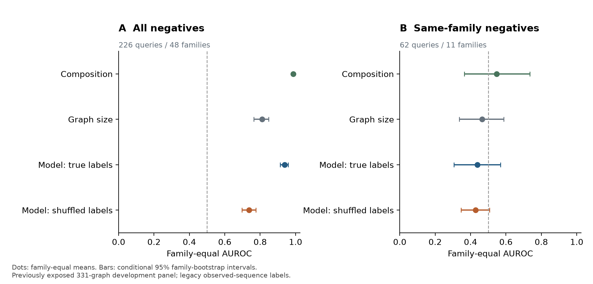
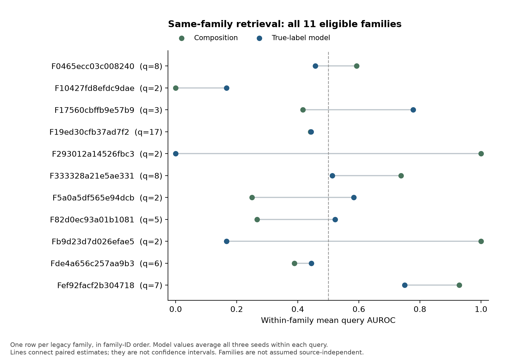
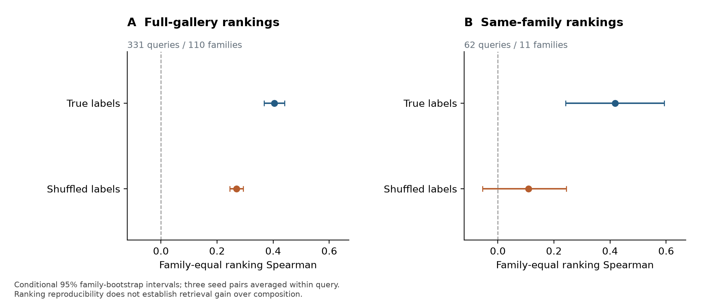
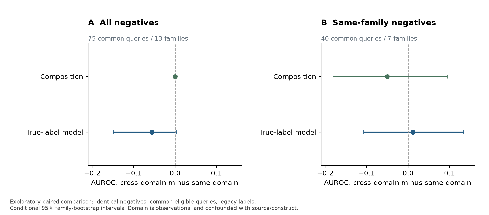

# 结构身份检索中的标签、组成基线与稳定性：一个331图开发面板的审计

图表审阅稿，2026-10-25。本文限定于一个已暴露的开发面板和指定模型配方，不主张结构表征普遍无用。已补入4张结果图及方法附录，尚缺文献定位与投稿格式，不是待提交终稿。

## 摘要草稿

结构身份检索常以同一受体的结构互相检索作为表征质量指标，但身份定义、组成相似性和结构来源可能共同影响结果。我们审计了含331张结构图的既有开发面板，发现基于整条观测链字符串的受体键会将经完整配对变量链证据确认的同一序列身份拆分，并产生假负例与跨折身份共享。修正训练实现后，在固定五折、三个种子、120个epoch的协议下完成15个真实标签和15个训练标签置换实例。在可定义困难检索的62个查询、11个家族中，家族等权AUROC为0.4385，组成基线为0.5475；配对差值为−0.1089，95%条件区间为[−0.3706,0.1220]。置换组AUROC为0.4280，真实减置换区间跨零。真实标签的排名稳定性高于置换组，但未转化为困难检索增益。严格身份准入后的25图开发诊断仍未超过组成，而且阳性全部来自同PDB副本，负对全部跨PDB，无法分离身份与来源。结果支持报告该流水线的评估缺陷与未建立增益的负结果，尚不支持跨来源结构身份泛化或真实结合预测。

## 研究问题与估计对象

1. 输入、索引与矩阵能否绑定，历史指标能否复算？
2. 固定实现和旧标签下，结构模型是否提供超出组成的检索证据？
3. 排名稳定性是否足以支持检索有效性？
4. 完整变量链修正后，是否已经具备来源平衡的评估条件？

主估计量是每个查询内平均三个种子的AUROC、再平均家族内查询、最后家族等权的模型减组成差值。同家族口径保留全部同旧身份正例，负例限制为同旧家族不同旧身份。没有正负两类的查询记NA，不补0.5。此处“负例”仅表示身份不同标签，不表示实验不结合。

## 方法与审计边界

- 面板：145张晶体图、186张预测图；160个旧观测链键、110个旧家族。不是331个独立受体。
- 固定协议：五折、种子20261021/1101/4242、最终epoch120；不选择最佳种子或检查点。完整冻结时间与偏离以对应RESULTS为准。
- 负对照：每折三个训练标签置换，留出真值不变。是描述性负对照，不是校准的置换检验。
- 区间：固定训练模型和固定画廊下，家族重采样2000次。未重采样训练过程或研究来源，不能视作总体泛化区间。
- 独立复算：本次使用sklearn的AUROC和SciPy的Spearman，从30套矩阵及嵌入重算两个主要口径；未调用原query_auc或bootstrap_ci。原报告均值及区间在1e−12容差内一致。
- 对齐补证：旧15实例另用现有脚本重跑训练折拟合的正交Procrustes，保存拟合／评价索引与源哈希。该诊断属于旧缺陷模型，不与修复后实例混用。
- 数据范围：未访问独立实测SPR、功能或临床验收集；本轮未训练模型。

## 结果一：正确复算不等于身份标签有效

精确逐图索引恢复旧seed20261021的五折池化AUROC算术均值0.7943805。旧标签和旧家族各自均不跨折，但经核验的完整配对变量链身份确有跨旧折实例。旧键只是观测链哈希，不能当作生物学受体身份。历史指标的复算成功不能解除这一缺陷。

实际331图的置信度原始列全部为0.5，归一化后全部为0。因此不能以这列在晶体／预测结构间变化解释此文件的域差异。

## 结果二：总体成绩与困难检索的结论不同

| 方法 | 全部负例家族等权AUROC | 同家族困难AUROC |
|---|---:|---:|
| 组成 | 0.9872 | 0.5475 |
| 图大小 | 0.8112 | 0.4650 |
| 修复后模型，真实标签 | 0.9379 | 0.4385 |
| 修复后模型，训练标签置换 | 0.7368 | 0.4280 |

困难检索模型减组成为−0.1089 [−0.3706,0.1220]；真实减置换为+0.0106 [−0.0902,0.1071]。结果没有建立困难检索的监督增益，也没有证明模型与置换组等效或模型总体劣于组成。总体口径包含更容易的不同家族负对，不能替代主口径。图大小点估计及区间已从冻结图输入独立复算，与原JSON在1e−12容差内一致。

图1：圆点为家族等权AUROC，横线为固定模型和画廊条件下的95%家族bootstrap区间。左侧全部负例226查询／48家族，右侧同家族困难负例62查询／11家族；虚线为0.5参考。不同方法单独区间的重叠情况不能替代配对差值区间。

图2：以家族ID排序，完整展示11个家族及查询数。蓝点为先平均三个种子的模型AUROC，绿点为组成；连线仅连接配对估计，不是区间。6个家族模型高于组成，5个低于组成，不能描述为各家族一致失败。省去任意单个家族的描述性均值差仍为负（约−0.1560至−0.0198），但这不是新的区间或删组后的主结果。全部家族始终保留。

## 结果三：稳定性有差别，但不能替代有效性

| 排名Spearman，家族等权 | 真实标签 | 置换标签 |
|---|---:|---:|
| 全画廊 | 0.4036 | 0.2690 |
| 同家族 | 0.4177 | 0.1097 |

新增事后探索性配对稳定性差值：全画廊+0.1345 [0.0872,0.1816]，同家族+0.3080 [0.1098,0.5616]。这些是条件家族区间，不是新的确认性检验。它们反驳“置换与真实标签的稳定性完全相同”这一具体解释，但不构成结构信息优于组成的证据。稳定排序可以稳定地排序错误。

旧实例的训练折Procrustes补跑中，五折拟合／评价索引不相交，实例内部余弦最大改变量约3×10−15。旧全画廊排名稳定性约0.948仍只是旧缺陷产物的诊断；对齐不能恢复其科学有效性，不能用该数值替换修复后0.4036。

图3：三个种子对先在查询内平均，随后查询与家族平均。全画廊稳定性有331查询／110家族，同家族口径筛选可定义困难检索的62查询／11家族；两个人口不同。横线为条件95%家族区间。图示不能直接推导出结构模型的检索或生物学效度。

## 结果四：精确索引的跨域分析仅为探索性诊断

本次在相同查询及相同负例集合下，分别使用同域与跨域正例计算AUROC。只比较两种条件均有正例的共同查询，避免直接比较两个不同查询群体；不跨折池化分数。按种子、查询、家族层次平均。

| 共同查询口径 | 查询／家族 | 模型同域 | 模型跨域 | 跨域减同域，条件95%区间 |
|---|---:|---:|---:|---|
| 全部负例 | 75／13 | 0.9408 | 0.8850 | −0.0558 [−0.1494,0.0035] |
| 同家族负例 | 40／7 | 0.5023 | 0.5141 | +0.0117 [−0.1075,0.1338] |

组成基线在上述两口径的跨域减同域分别约0.0000与−0.0503，区间均跨零。共同查询中预测图占比分别64/75和32/40，方向并不平衡；旧身份键仍不可靠。不同困难度口径给出不同点估计方向，不能把旧近似映射的0.08差值恢复成确定域效应，也不能据此宣称域不变性。这不是随机化域实验或泄漏对照。

图4：共同可定义查询、固定相同负例下，跨域正例AUROC减同域正例AUROC。每个差值在查询内先计算，再平均种子及家族。两种负例口径使用不同共同查询人口；区间均跨零，不支持确定的域效应或域不变性。

## 结果五：身份修正后仍受来源混淆限制

当轮完整变量链规则准入46/331图、24个配对序列身份；25图开发池中仅两个困难组、8个可定义查询。参考模型0.4861、保留身份one-hot模型0.5000、置换0.6667，组成与图大小均1.0000。这一极小面板的全部正对来自同PDB副本、全部负对跨PDB。任何模型成绩都不能分离身份与来源；也不能把两轮结果之差归因于去泄漏。

最新已有取证扩展记录61个PDB、41个完整变量链序列身份通过身份层；30个PDB的42个链对单元通过固定原子QC，但仍有0个QC合格跨研究正对照对、0个来源平衡块。新增JDI同研究同V工程构建体对照不等于独立天然克隆，也不能补成跨研究正例。这里引用现有扩展记录及本次核验的文件哈希，不声称本次重演全部原子QC。

## 讨论草稿

本审计显示，索引正确、指标可复现、标签科学有效和跨来源泛化是不同的证据环节。简单组成基线揭示总体AUROC不足以证明结构特异增益；置换对照与稳定性共同说明，重复训练的一致性不能单独验证目标监督信息。完整变量链身份能纠正部分假负例，却不能自动建立独立来源的评估。

当前负结果限定于给定模型、配方、图表示和开发样本。不能推广为几何没有价值、结构路线失败或结合预测不可行。原子QC是任务准入规则，不是物理金标准；固定粗筛拒收不意味着原结构不可能。家族聚类也不保证来源独立。审计论文的贡献应落在明确展示失效路径、精确索引与可复算证据链，不能将单流水线结果写成普遍性能排行。

## 方法、版本及证据附录

[方法补充与证据对应表](METHODS_AND_EVIDENCE.md)明确区分旧v2、修复后固定重训、2×2诊断、完整身份开发和跨来源取证五个版本，列出统计人口、冻结措辞和每项主张的证据位置。组成取全图节点的AA列均值；图大小取对数节点数的负绝对距离。画廊包含训练与留出图，不能称为纯新结构画廊盲测。

4张图同时提供SVG和PNG；figure_data.csv为区间图源数据，family_detail.csv为全部逐家族点估计，build_figures.py与figure_verification.json绑定输入哈希并核对主差值。图像已经逐张检查，无文字裁切或区间截断。复算及绘图没有修改原始模型、标签或结果文件。

## 收尾计划与止损

已完成结果图、逐家族表、方法与证据对应表。剩余稿件工作为文献定位、原始冻结时间线附件核对、投稿格式和独立科学审阅。无需等待正向性能结果才能推进这些工作。

新增实验仅在身份、共同gallery来源、困难对照和既定QC同时满足时才进入协议冻结。模型、组成、大小与置换须共用分区、查询人口和统计口径；不因已见分数改标签、阈值或挑种子。完整身份校正涉及评估真值变化，不能简单把新旧AUROC相减解释为泄漏贡献。

沿用前次建议的2026-11-21为可选收尾节点，尚未由用户确认为硬性日程，未设置自动任务。到期若仍不具备评估条件，就报告缺口；若具备条件但仍没有增益，就完整报告负结果。数据准入不足本身不证明结构无用。

## 证据文件

- 独立复算：[结果](../audit_followup_20261025/independent_metric_replay.json)与[脚本](../audit_followup_20261025/verify_metrics.py)。
- 跨域诊断：[结果](../audit_followup_20261025/cross_domain_diagnostic.json)与[脚本](../audit_followup_20261025/cross_domain_diagnostic.py)。
- 对齐补跑：[报告](../audit_followup_20261025/procrustes_train_only/rashomon.md)与[JSON](../audit_followup_20261025/procrustes_train_only/rashomon_results.json)。
- 历史报告及精确索引：../audit_handoff_20261024/。
- 最新已有取证摘要：[报告](../audit_followup_20261025/sources/cross_source_extension_README.md)、[联合准入](../audit_followup_20261025/sources/joint_readiness.json)、[历史验收](../audit_followup_20261025/sources/verification.json)。

源报告的历史验收次数与本次独立矩阵复算分别标记；本次没有重新训练、获取新结构或重演全部身份／原子QC。

