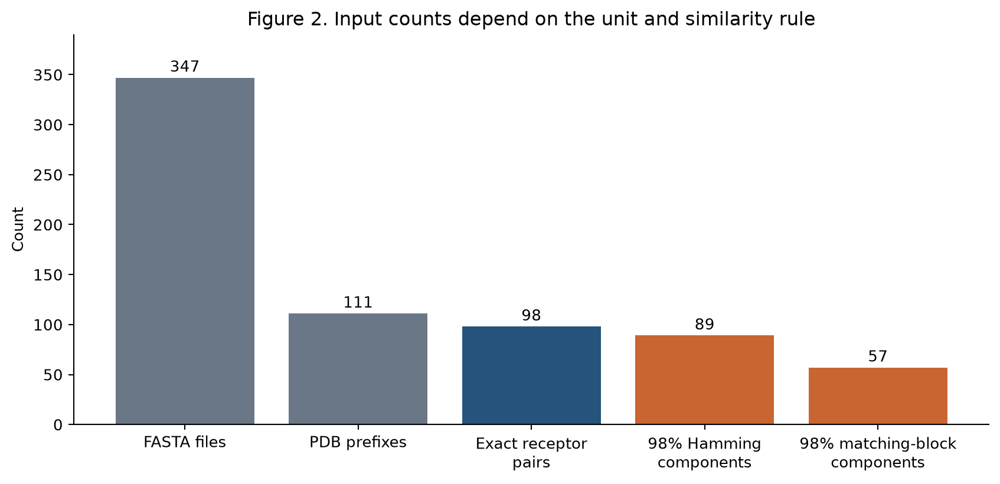
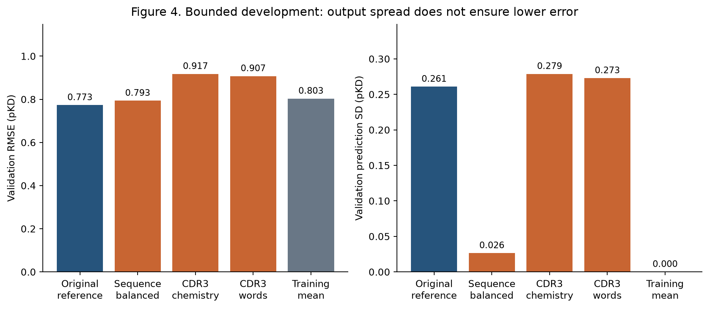

# Decoy artifacts and limited source-disjoint affinity prediction in a TCR-pMHC computational workflow

Single-author manuscript for author review. Author name, affiliation and corresponding email will be supplied before submission.

## Abstract

Predicting T cell receptor (TCR) recognition requires an explicit distinction between synthetic structural discrimination, measured binding affinity, cellular activation and clinical toxicity. We examined these distinctions in a retrospective case study of the Meta-ACDC computational workflow. An atomic audit covered 300 native structural records and 588 reconstructed synthetic controls. A fixed severe-overlap screen, using peptide-environment heavy-atom distances of at most 1.2 A, flagged 146 of 288 grafted controls and all 300 displaced controls, compared with none of the native records. The graft flag rate was 50.7% per record and 58.0% with equal weight per inherited audit family. These observations identify a potential construction shortcut; they do not establish whether a trained model used it. A separate panel of 347 structure-prediction inputs contained 98 exact paired receptor sequences, illustrating the difference between file counts and receptor units. In a previously locked, source-separated SPR affinity experiment, a Ridge model trained on ten observations achieved a source/lineage-weighted test RMSE of 0.9962 pKD, versus 1.0036 for the training-mean comparator, across fourteen primary observations from seven lineages and three source components. Three bounded development alternatives did not improve both validation metrics over the reference model. Retained weights and inputs reproduced 938 of 940 historical seed-level means to four decimal places, while the underlying biological claims remained withdrawn. Public coordinate extracts, analysis code, tables and provenance records support inspection of the case study. The results motivate explicit endpoint contracts, construction controls and source-aware evaluation; they do not validate a general binding predictor or clinical safety model.

## Introduction

TCR-pMHC prediction encompasses several distinct questions. A receptor can be evaluated for an assay-specific soluble binding affinity, recognition in a multimer assay, activation in a cellular system, or an adverse outcome in a therapeutic setting. A prediction target defined by one of these measurements does not automatically provide labels for the others. Databases such as VDJdb collect specificity evidence, whereas ATLAS links experimentally reported affinities to receptor-pMHC structures and mutations [1,2]. Their contents require endpoint-specific interpretation before model training.

Evaluation also depends on the origin and independence of examples. Published benchmarking has examined sensitivity to negative-data construction and differences between internal and external prediction tasks [3]. Repeated structures, engineered variants, and measurements from related studies may contribute useful observations while providing fewer independent experimental units than their row count suggests. These concerns apply to any workflow claiming generalization beyond its development collection.

Structural synthetic controls introduce an additional question: whether a method distinguishes biological interactions or the procedure used to construct an example. Moving a peptide or transplanting side chains can change atomic geometry as well as its intended interaction pattern. Structure-validation methods assess several aspects of local chemistry and geometry, including hydrogen-aware contacts and torsion angles [4]. A simple distance screen addresses only one part of this problem. Likewise, a predicted structure is an input hypothesis rather than a direct measurement of receptor function; AlphaFold 3 provides structural predictions, not assay labels [6].

Here we examine one computational project in which broad binding and clinical interpretations were withdrawn after implementation and data-semantic defects were identified. We ask three bounded questions. First, do reconstructed historical controls contain severe atomic overlaps absent from the corresponding native collection? Second, how do file counts differ from receptor units in an actual prediction-input panel? Third, what predictive advantage remains in an explicitly separated, very small SPR affinity experiment, and did a fixed set of development alternatives improve it? We also examine whether historical score provenance can be reconstructed without restoring the biological interpretation of those scores.

This is a retrospective analysis of a single workflow. It does not estimate how frequently these problems occur across the field, rank published predictors, or test a new clinical application. The contribution is a linked set of inspectable observations and practical reporting constraints, with failures and unresolved evidence retained.

## Methods

### Study scope and versioned evidence

The primary evidence snapshot is repository commit e4d68de653fca18ce179f76ceac39b95cb5c5277; a separately pinned later update supplies contextual functional and non-detection evidence. Fifteen public JSON reports and protocols are enumerated by SHA256 in source_manifest.json. The report-assembly plan was written before the new descriptive aggregation, after the source findings were known. It is a retrospective analysis plan, not a prospective preregistration. Historical experiment plans, model locks and test-access records retain their original dates and hashes.

No model was fitted, selected or newly evaluated for this manuscript assembly. The consumed affinity test is represented by its public aggregate acceptance report. Its individual labels and predictions were not loaded by the report builder. New SPR reserves and clinical candidates were not opened for scoring. Separate files distinguish historical structural evidence, affinity regression and clinical reference material.

### Atomic construction audit and public coordinate verification

The historical collection comprised 300 native records, 288 per-residue side-chain graft controls and 300 fixed-direction displacement controls. Crystal and predicted records may represent related complexes. Each record retained its inherited family identifier and fold. These identifiers are audit grouping units, not proof of independent biological families.

The retained audit reconstructed coordinates from the declared source chains and construction recipes. Grafting aligned each donor residue's N, CA and C atoms to the corresponding native backbone and transferred the other side-chain atoms without relaxation. Displacement translated peptide atoms by 6 A along the coordinate z axis. Neither construction establishes experimental nonbinding. The native and synthetic records were assessed with the same heavy-atom screen. A record was flagged when at least one peptide atom and non-peptide environment atom were separated by at most 1.2 A. The stored screen also checks CA-CB completeness and distance; all construction failures reported in the present comparison contained severe cross-chain overlaps.

The 1.2-A cutoff was inherited from the earlier audit, with no search for a more discriminative threshold during manuscript preparation. It is a coarse engineering screen. It does not include optimized hydrogens, a rotamer library, crystallographic density inspection or a force-field assessment, and is not a MolProbity clashscore [4]. A pass cannot establish an appropriate bound conformation or a binding/nonbinding label.

We matched each synthetic record to its native parent by the retained identifier and checked family correspondence. We report overlap prevalence per record and the unweighted mean of within-family prevalence. A fixed QC-only rule calls a record synthetic when the severe-overlap flag is present. Its sensitivity and specificity are described on this complete historical collection, with each synthetic record paired to its native parent. This is a retrospective construction-discrimination calculation, not held-out performance or a binding evaluation. No row-independent significance test or population confidence interval is asserted.

For coordinate-level replication, the supplement provides native residue/atom extracts and the reconstructed peptide atoms for all controls. Every construction-screen result was checked against the retained audit during export. A second verifier computes distances directly with a Python standard-library spatial cell grid, independently of the original KD-tree counting implementation. Source names and source-file hashes identify the inputs. The extracts are derived structural data, not new experimental measurements.

### Prediction-input panel and receptor-unit sensitivity

The 347 FASTA inputs in af3_pending_upload were checked against their first repository commit, 4f730d28f39c0167aad00d7724fe6a1516607366. The manifest-to-file mapping was one-to-one. Exact paired receptor units were defined by equality of the complete supplied alpha and beta construct strings. They were not defined by PDB prefix or filename.

Two previously specified 98% full-construct similarity rules illustrate grouping sensitivity. The first uses equal-length positional identity; the second uses SequenceMatcher matching-block length divided by the longer string length. Both require each corresponding chain to meet the threshold, and groups are connected components. These component counts are not validated variable-region or V-gene families and were not used to create a new independent test. The original external review's reported 73 clusters could not be reproduced without its exact algorithm; the rules were not adjusted to obtain that number.

### Locked SPR affinity experiment

The endpoint was assay-specific soluble human alpha-beta TCR binding to canonical class-I pMHC, measured by SPR and represented as pKD = -log10(KD in molar). Exact positive affinity values were required. Censored non-detections, cellular readouts and clinical outcomes were not converted to continuous pKD labels. Identity, peptide, HLA restriction, measurement conditions and source locators were curated in the parent records. ATLAS supplied historical development measurements [2]; the five external study sources are listed in Supplementary Table S5 [7-11].

The frozen recipe contained ten training observations in five connected blocks and ten validation observations in five blocks. Source-overlapping development records were excluded without moving old folds. Fifteen observations from seven receptor lineages, five studies and three coauthor-connected source components were retained for external reporting; fourteen formed the primary metric. The remaining S8WT/HLA-A11 value was retained only in sensitivity analysis because it exceeded the explicitly documented maximum concentration under the project's conservative rule. This exclusion does not establish that the published fit was invalid.

The family reservation rule conservatively excluded overlap through either corresponding chain. Sequence comparison requires at least 0.9 length ratio and 0.9 SequenceMatcher similarity in the extracted variable regions, with at least 0.9 CDR3 similarity when both CDR3s are available; an additional near-CDR3 reservation rule also operates. Peptide similarity of at least 0.8 and same-study membership contribute to connected test blocks. Research-source components join studies with overlapping normalized author names or ORCID identifiers. This is a conservative provenance proxy, not proof that laboratories or biological populations are wholly independent. The protocol does not establish V-gene disjointness.

The baseline used normalized one- and two-residue counts, scaled lengths for alpha variable region, beta variable region and peptide, a 20-by-20 receptor/peptide composition-product block, MHC and instrument categorical indicators, and temperature terms. The 1,014-dimensional vocabulary was fitted on training observations only. Unknown categories and terms contribute zero at application. Training and validation used equal total weight per connected block. Ridge alpha was selected from 1, 10 and 100 by validation RMSE, with a lower-alpha tie-break and no validation refit. The model was locked before a separate process opened the test.

For test metrics, each source component had equal total weight, each lineage within a source had equal weight, and observations within a lineage shared that weight. RMSE and MAE were compared with the connected-block-weighted training mean. The version-controlled exploratory rule required lower primary RMSE and MAE and lower RMSE in each leave-one-source-out metric subset. Those subsets reuse fixed predictions and do not retrain a model. Three source components are insufficient for precise population uncertainty claims; no significance result is inferred from satisfying this rule.

### Bounded development and provenance reconstruction

A later development protocol retained the same ten training observations and excluded one validation observation, ATLAS:485, before fitting candidates because it shared a research source with a newly reserved study. The resulting validation set had nine observations in four inherited blocks. Three alternatives were fixed in advance: grouped sequence features without assay metadata, CDR3-region chemical features, and CDR3-region features augmented with two-residue words. Regularization was selected solely by leave-one-training-block-out cross-validation, with preprocessing refitted within each inner fold. The reference alpha of 1 was inherited from the earlier validation selection. Its historical exposure is disclosed; removing a record later cannot erase that configuration history.

The current manuscript reports all four candidates and the training-mean comparator. No additional search was launched after the alternatives failed. Feature-contribution decompositions are descriptive linear-model calculations. Correlated contributions cannot be added as independent variances or interpreted as causal feature importance.

Historical score reconstruction used five retained checkpoints, 884 retained AF3 model files and isolated source commit 5c70164de873c0a1b818cb807efda9c32d2dc3de. Of 188 jobs, 174 had five AF3 inputs and fourteen had one; absent models were not fabricated. Replayed values were compared at the original four-decimal reporting precision. These are present-day reconstruction records, not historical attestations of command, execution time or overwrite order. A separate 21-job scoring table has an unresolved original checkpoint and remains excluded from biological interpretation.

## Results

### Severe overlaps distinguished synthetic construction records

The fixed screen flagged 0/300 native records, 146/288 graft controls (50.7%) and 300/300 displaced controls (100%; Figure 1). Nine native records contained incomplete interface heavy atoms in the retained audit. The construction categories included 86 inherited audit families for native and displacement records and 83 for grafts. Family-balanced overlap prevalence for grafts was 58.0%, compared with the record-weighted 50.7%. Thus repeated records changed the descriptive weight assigned to affected groups.

In the paired construction-discrimination calculation, the fixed rule had native specificity 1.0 and graft sensitivity 0.5069, giving balanced accuracy 0.7535. For displacement controls both quantities were 1.0. These figures describe a visible construction signal in the audited collection. They do not measure binding specificity, establish biological nonbinding, or show that the historical neural model used that signal. The distance implementation and raw coordinate extracts allow this narrow finding to be checked without loading model weights.

The subsequent structural repair retained 168 unlabelled native assets, comprising 145 crystal and 23 predicted structures. All 588 old synthetic controls were retired. Only five pairs passed the replacement construction protocol, with no calibration or test pairs. Accordingly, the repair did not yield a validated structural binding dataset or justify a new structural classifier performance claim.

### Files, receptor constructs and similarity components were different units

All 347 input FASTA files matched their first committed bytes. They represented 111 PDB prefixes, 91 unique peptide strings and 98 exact paired receptor construct sequences. The two declared similarity rules produced 89 positional-identity components and 57 matching-block components (Figure 2). Neither establishes a biological family count. Reporting only 347 would therefore overstate receptor variety if interpreted as 347 independently sampled receptors; reporting an unexplained clustering result would also obscure substantial rule dependence.

Fifty-three beta strings began with NA and 279 MHC strings began with GS. These prefixes alone do not identify invalid residues or removable expression tags. No automatic trimming was applied to force agreement with an external review. Construct processing requires sequence-specific source evidence.

### Source-separated affinity prediction provided minimal advantage

The locked Ridge model achieved primary weighted RMSE 0.9962 pKD and MAE 0.8486 pKD, compared with 1.0036 and 0.8531 for the training-mean comparator (Figure 3). The absolute RMSE reduction was 0.00742 pKD, or 0.739% relative to the comparator. Including the fifteenth sensitivity observation gave RMSE 1.0241 versus 1.0312. These differences met the original exploratory rule but did not establish a useful predictive advantage.

The retained aggregate report also records heterogeneity: RMSE was slightly lower in each source component, whereas MAE was slightly worse in two of the three. No conclusion of uniform improvement across sources is supported. Seven lineages and three source components, rather than fourteen independent draws from a target population, define the main limits on interpretation.

### Broader prediction variation did not resolve development error

On the source-safe nine-observation validation set, the original reference had RMSE 0.7729 and MAE 0.5995 pKD. The three alternatives had RMSE 0.7932, 0.9175 and 0.9073, respectively (Figure 4). None improved both metrics over the reference. The training mean had RMSE 0.8029. Removing metadata and balancing sequence features produced particularly compressed predictions, with validation prediction SD 0.0264; the other alternatives expanded variation without reducing error.

The initial ten-observation training design had 1,014 features and at most nine centered sample directions. Across the original validation set, the standard deviations of the linear contributions were 0.2711 pKD for MHC indicators, 0.0508 for instrument indicators, and 0.0569 for the remaining sequence, interaction and temperature terms. The last category contains constant temperature terms and should not be described as purely sequence-derived. These observations are compatible with weakly constrained sequence directions and metadata-associated variation. They do not establish a unique causal explanation or show that sequence information is intrinsically insufficient.

### Reconstructed numerical provenance did not restore biological validity

Of 940 historical job-by-seed means, 938 matched the archived value to four decimal places. The remaining two differed by 0.0001. At the per-structure level, 4,417 of 4,420 values matched at that precision and three differed by 0.0001. All fifteen seed-level values for the three disputed 5BRZ peptide jobs matched. Numerical roundoff or environment differences may explain the small discrepancies, but their cause has not been isolated.

These reconstructions link most historical values to available computation and inputs. The old implementation's encoding, pooling, construction and interpretation defects remain grounds for withdrawal. A structural MAG-IC3 reagent is also not interchangeable with the clinical a3a construct; the primary structural study distinguishes these engineered receptors [5]. No reconstructed score was promoted to a binding probability or clinical risk label. The separate 21-job table's checkpoint remains unresolved.

### Separate functional comparison and conditional SPR non-detection

A subsequent project update, pinned separately to commit 15eb5c6, supplies contextual evidence without changing the affinity experiment. One fixed official ERGO-I McPAS/LSTM checkpoint [12] was applied without retraining or threshold tuning to the same previously consumed MIRA panel as an earlier SPR-reference score. Among 10,000 functional observations over 1,000 receptors and twenty peptides, per-peptide macro AUROC was 0.51125 for ERGO and 0.50008 for the reference score; macro average precision was 0.11663 and 0.11969, respectively (Supplementary Table S7). Neither comparison demonstrates useful advantage or statistical superiority. The models have different training targets and inputs. Exact beta-CDR3 overlap affected 120 observations, and full receptor-family/source independence is unresolved, so this is not new independent acceptance or a matched SPR regression benchmark. The upstream batch-output issue and its pre-metric execution-control amendment are retained in the supplementary provenance.

The later update also documents TCR4 binding to a neoantigen but no detectable binding to wild-type peptide/HLA-A3 at a highest tested concentration of 208.24 microM [13]. This is an assay-conditioned non-detection, not a numeric KD or lower bound. Because this lineage was already exposed, it supplied no new independent acceptance data and was not rescored.

## Discussion

This case study identifies three different constraints on a TCR-pMHC prediction workflow. Synthetic construction generated severe contacts detectable with a fixed geometric rule. Input-file counts did not represent receptor counts, and similarity-group counts depended on the comparison rule. An affinity experiment with explicit source separation showed only minimal improvement over a constant comparator. Each observation is narrower than a claim about general TCR specificity prediction, but together they define why this project's earlier broad interpretations were unsupported.

The geometry result motivates a direct control for construction artifacts. Demonstrating that such a signal exists is a necessary diagnostic, not proof that a learned model exploits it. Establishing dependence would require controlled model analyses in which the candidate artifact and biological endpoint are separately measured. The present collection lacks experimentally verified nonbinding labels for synthetic controls, so retraining on those labels would not answer that biological question. Further energy optimization alone would also not supply the missing labels. Subsequent main-branch code changed the displacement direction to a peptide-versus-MHC-centroid direction. The present 300/300 result applies to the archived fixed-axis protocol, not that revised generator; its output would require a separate audit.

The affinity result has a different limitation. Strict curation and source separation reduced the available development data to a size that poorly constrains the chosen representation. A complex architecture cannot be justified by feature count or by the availability of structures alone. The bounded alternatives provide an informative failure within this protocol: increasing output variation did not improve the fixed validation comparison. This outcome does not exclude improvements from substantially larger data, external representations or better task definitions. Those hypotheses require a new development plan and genuinely unconsumed evaluation data.

Several limits restrict generalization. All structural observations originate from one project and its construction rules. Audit families were inherited rather than independently established by complete receptor annotation. The overlap cutoff is a severe-distance screen and passing examples may retain other defects. Source components use coauthor metadata and are imperfect proxies for experimental independence. The affinity test contains only three components and seven lineages, with assay-specific conditions. No matched head-to-head comparison against published affinity predictors is presented; the functional association comparison addresses a separate endpoint. The results therefore cannot rank contemporary methods or establish an information limit for sequence or structure.

Clinical inference is outside the evaluated endpoint. An affinity or activation measurement does not determine a patient's risk, and receptor provenance must distinguish engineered constructs even when they share a progenitor. Clinical cases were selected retrospectively and lack an independently sampled, receptor-resolved validation cohort for this model. These data support reference checking and study design, not safety clearance.

The practical outcome is an explicit separation of data contracts and claims. Structural construction discrimination, soluble affinity regression, cellular function and clinical outcomes should retain their own eligibility criteria, units, uncertainty and independent validation requirements. Numerical reproducibility is an additional requirement that does not replace those biological distinctions.

## Data and code availability

The manuscript package is in docs/preprint_20261021 of https://github.com/QianRongAn/meta-acdc-compute on the audit/pretrain-20261016 branch. Its source_manifest.json pins the fifteen core report inputs to commit e4d68de653fca18ce179f76ceac39b95cb5c5277; context_manifest.json separately binds the later functional and assay evidence. The package includes source tables, four figures, a coordinate archive, a second distance verifier, a claim-to-evidence ledger and reproduction instructions. The report builder requires only the tracked reports and does not require private training data. Atomic verification uses the public coordinate extracts and only the Python standard library. Full historical neural-score replay additionally requires the original checkpoints and 884 input files; hashes and local recovery records are supplied, but those full neural-replay inputs are not all distributed in this package. That limit is stated rather than hidden by claiming a fully public end-to-end neural reproduction.

Original papers and databases retain their own terms. The coordinate extracts are derived from the project's archived public-structure and predicted-structure inputs. No third-party manuscript PDFs are redistributed with this package. The final submission will name the exact manuscript-package commit. The project metadata declares an MIT code license. Third-party source data retain their original terms; the preprint reuse license remains for the author to choose.

## Declarations

Author contributions: one human author is confirmed. The author will review and confirm the contribution statement, interpretations and all submission declarations before release.

Funding: to be confirmed by the author.

Competing interests: to be confirmed by the author.

Ethics: this report introduces no new participant recruitment, animal experiment or wet-laboratory experiment. It analyses archived structural and published experimental data; it makes no patient-specific recommendation.

AI assistance: AI tools assisted code preparation, evidence aggregation, literature retrieval and manuscript drafting, including proposed interpretation text. This document is an author-review draft. The human author must critically revise the interpretations, verify citations and results, and take responsibility for the submitted work. No AI system is an author.

## References

1. Bagaev DV, Vroomans RMA, Samir J, Stervbo U, Rius C, Dolton G, et al. VDJdb in 2019: database extension, new analysis infrastructure and a T-cell receptor motif compendium. Nucleic acids research (2020). https://doi.org/10.1093/nar/gkz874

2. Borrman T, Cimons J, Cosiano M, Purcaro M, Pierce BG, Baker BM, et al. ATLAS: A database linking binding affinities with structures for wild-type and mutant TCR-pMHC complexes. Proteins (2017). https://doi.org/10.1002/prot.25260

3. Lu Y, Wang Y, Xu M, Xie B, Yang Y, Xu H, et al. Assessment of computational methods in predicting TCR-epitope binding recognition. Nature methods (2026). https://doi.org/10.1038/s41592-025-02910-0

4. Chen VB, Arendall WB, Headd JJ, Keedy DA, Immormino RM, Kapral GJ, et al. MolProbity: all-atom structure validation for macromolecular crystallography. Acta crystallographica. Section D, Biological crystallography (2010). https://doi.org/10.1107/S0907444909042073

5. Raman MC, Rizkallah PJ, Simmons R, Donnellan Z, Dukes J, Bossi G, et al. Direct molecular mimicry enables off-target cardiovascular toxicity by an enhanced affinity TCR designed for cancer immunotherapy. Scientific reports (2016). https://doi.org/10.1038/srep18851

6. Abramson J, Adler J, Dunger J, Evans R, Green T, Pritzel A, et al. Accurate structure prediction of biomolecular interactions with AlphaFold 3. Nature (2024). https://doi.org/10.1038/s41586-024-07487-w

7. Smith AR, Alonso JA, Ayres CM, Singh NK, Hellman LM, Baker BM. Structurally silent peptide anchor modifications allosterically modulate T cell recognition in a receptor-dependent manner. Proceedings of the National Academy of Sciences of the United States of America (2021). https://doi.org/10.1073/pnas.2018125118

8. Chandran SS, Ma J, Klatt MG, D眉ndar F, Bandlamudi C, Razavi P, et al. Immunogenicity and therapeutic targeting of a public neoantigen derived from mutated PIK3CA. Nature medicine (2022). https://doi.org/10.1038/s41591-022-01786-3

9. Gaglione SA, Rosales TJ, Schmidt-Hong L, Baker BM, Birnbaum ME. SARS-CoV-2 spike does not interact with the T cell receptor or directly activate T cells. Proceedings of the National Academy of Sciences of the United States of America (2024). https://doi.org/10.1073/pnas.2406615121

10. Karuppiah V, Sangani D, Whaley L, Pengelly R, Uluocak P, Carreira RJ, et al. Broadening alloselectivity of T cell receptors by structure guided engineering. Scientific reports (2024). https://doi.org/10.1038/s41598-024-75140-7

11. Wu D, Yin R, Chen G, Ribeiro-Filho HV, Cheung M, Robbins PF, et al. Structural characterization and AlphaFold modeling of human T cell receptor recognition of NRAS cancer neoantigens. Science advances (2024). https://doi.org/10.1126/sciadv.adq6150

12. Springer I, Besser H, Tickotsky-Moskovitz N, Dvorkin S, Louzoun Y. Prediction of Specific TCR-Peptide Binding From Large Dictionaries of TCR-Peptide Pairs. Frontiers in immunology (2020). https://doi.org/10.3389/fimmu.2020.01803

13. Ma J, Ayres CM, Brambley CA, Chandran SS, Rosales TJ, Perera WWJG, et al. Dynamic allostery in the peptide/MHC complex enables TCR neoantigen selectivity. Nature communications (2025). https://doi.org/10.1038/s41467-025-56004-8

